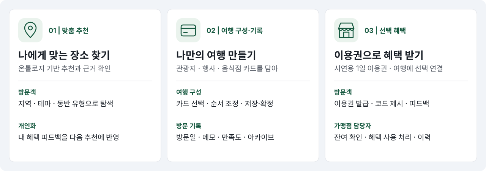
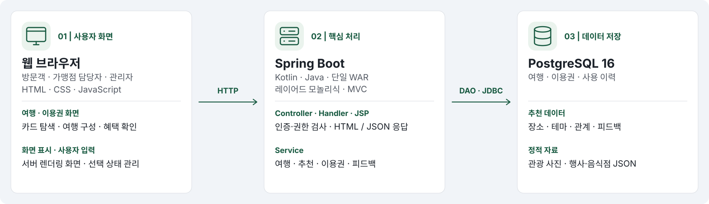

# siheung-tourpass

## 소개

시흥시 관광 장소를 추천하고 혜택 이용 후 피드백을 다음 추천에 반영하는 수업용 웹서비스. 추천 장소를 개인 여행 패스에 담고 방문 기록을 보관한다. 혜택 이용권은 시연용·실제 사용 불가다.

관광지·행사·음식점을 함께 발견하고 여행 후에도 기록을 다시 찾는 흐름을 제공한다. 기획 근거와 효과를 확인할 과제는 [지역 문제와 사용자 검증](docs/project-validation.md)을 참고한다.



## 기술 스택

Kotlin·Spring Boot 3.5·Spring MVC·JSP/JSTL·Java 17·JDBC·PostgreSQL 16 이상·Maven 3.9. 구현 경계는 [구현 계획](plan.md#기술-구조)을 따른다.



## 시작하기

명령은 저장소 루트에서 실행한다.

1. Java 17·Maven 3.9·PostgreSQL 16 이상·Python 3과 PostgreSQL 클라이언트(`createdb`·`psql`)를 준비한다. 빈 DB에 아래 순서로 스키마·시연 계정/혜택·실제 관광 자료를 적재한다. 기존 DB에 초기화 SQL을 재실행하지 않는다.

   ```sh
   createdb -U postgres -E UTF8 siheung_tourpass
   psql -X -v ON_ERROR_STOP=1 -U postgres -d siheung_tourpass < backend/sql/schema.sql
   psql -X -v ON_ERROR_STOP=1 -U postgres -d siheung_tourpass < backend/sql/seed.sql
   python3 backend/scripts/tourism-sql.py --replace-demo > /tmp/siheung-tourism.sql
   psql -X -v ON_ERROR_STOP=1 -U postgres -d siheung_tourpass < /tmp/siheung-tourism.sql
   ```

   기존 DB는 초기화 SQL 대신 백업 후 [마이그레이션 디렉터리](backend/sql/migrations)의 SQL 중 아직 적용하지 않은 파일만 번호 순서대로 한 번씩 적용한다. 각 파일의 적용 명령은 `psql -X -v ON_ERROR_STOP=1 -U postgres -d siheung_tourpass < 파일경로`다. 신규 스키마에는 이미 포함되어 있다. 새 테이블이 추가되면 2단계의 앱 계정 권한 부여도 다시 실행한다.

2. DB에서 앱 전용 계정을 만들고 테이블의 SELECT·INSERT·UPDATE·DELETE와 identity 시퀀스의 USAGE 권한을 부여한다.

   ```sql
   CREATE ROLE tourpass LOGIN;
   -- psql에서 \password tourpass로 비밀번호를 설정한다.
   GRANT CONNECT ON DATABASE siheung_tourpass TO tourpass;
   GRANT USAGE ON SCHEMA public TO tourpass;
   GRANT SELECT, INSERT, UPDATE, DELETE ON ALL TABLES IN SCHEMA public TO tourpass;
   GRANT USAGE ON ALL SEQUENCES IN SCHEMA public TO tourpass;
   ```

   앱 실행 환경에 연결 정보를 설정한다. 비밀번호는 로컬 환경으로만 전달한다.

   ```sh
   export TOURPASS_DB_URL='jdbc:postgresql://127.0.0.1:5432/siheung_tourpass'
   export TOURPASS_DB_USER='tourpass'
   read -r -s TOURPASS_DB_PASSWORD
   export TOURPASS_DB_PASSWORD
   ```

   외부 Tomcat 배포에서 환경 변수가 없으면 Tomcat JNDI `java:comp/env/jdbc/TourpassDB` DataSource를 사용한다. JNDI 방식에서는 PostgreSQL JDBC 드라이버를 Tomcat `lib`에 제공한다.
3. 같은 환경에서 빌드하고 실행한다. JSP 때문에 JAR 대신 WAR를 사용한다.

   ```sh
   mvn -f backend/pom.xml clean package
   java -jar backend/target/siheung-tourpass.war
   ```

   외부 Tomcat 10.1을 사용하는 경우 WAR를 `webapps`에 복사하고 `bin/catalina.sh run`으로 실행한다. 두 실행 방식 중 하나를 사용한다. 포트는 내장 실행 시 `--server.port=8081`로 변경할 수 있다.

실제 관광 자료의 승인·기존 DB 전환은 [데이터 안내](docs/data-collection/tourism-data.md#적재)를 따른다.

## 사용 방법

화면은 `http://localhost:8080/siheung-tourpass/`, API는 같은 주소의 `/api/v1`. 시연 계정 `visitor`, `visitor2`, `staff-a`, `staff-b`, `admin`의 초기 암호는 모두 `DemoPass!2026`이다.

| 역할·화면 | 사용 흐름 |
| --- | --- |
| 방문객 | 여행 만들기에서 빈 구성·템플릿 선택 → 카드 탐색·선택·순서 확인 → 이름·날짜 임시 저장 → 이어 만들기·제작 확정 → 내 패스 → 방문 기록 → 사용 완료 → 여행 기록 조회 |
| 카드 탐색 | ‘새 여행 만들기’에서 테마 선택 → 시작 카드 선택·확인 → 덱 구성에서 가까운 카드 이어 고르기(직선거리 기준) → 여행 확인. 직접 찾기에서 검색·지역·행사 날짜·동반 유형 설정 가능. 가로 스크롤·스와이프·마우스 드래그로 탐색하고 여행 확인 화면에서 저장. 비로그인 탐색 가능, 저장 시 방문객 로그인 필요 |
| 행사 | 로그인 없이 ‘여행 카드 둘러보기’에서 행사 종류·날짜로 검색하고 상세 확인. 변경·접수 조건은 공식 안내 링크에서 확인 |
| 선택 혜택 | 상품에서 이용권 발급 → 여행 설정에서 연결 → 담당자에게 코드 제시 → 사용 후 피드백 |
| 관광지 피드백 | 관광지 카드 상세에서 만족도·선택 의견 저장/수정/삭제. 관리자는 통계에서 관광지별 집계 확인 |
| 프로필 | 계정 정보·화면 설정·로그아웃 |
| 담당자 | 코드 입력 → 배정 혜택·잔여 확인 → 사용 확인 → 이력 조회 |
| 관리자 | 상품·가맹점·혜택·장소·개념·관계 관리, 자료 검토, 사유 입력 후 이용권 취소. 관광 관리에서 카드의 출력 버튼 → 문구·수량·접속 주소 설정 → 미리보기 → 인쇄/PDF 저장 |

초기 자료의 담기 조건은 [여행 구성](docs/specs/visitor.md#담기와-보존), 추천 승인 절차는 [데이터 적재](docs/data-collection/tourism-data.md#적재)를 따른다.

굿즈는 A4 세로, 배율 100%, 머리글/바닥글을 끄고 출력한다. QR에는 서비스 경로까지 포함한 접속 주소를 설정하고 휴대전화로 열리는지 확인한다. 사진 이용 범위는 [굿즈 정책](docs/specs/admin.md#관리자-작업과-카드-출력)을 따른다.

### API

`GET /api/v1/`에서 시작해 응답의 `_links`에 있는 `href`·`method`를 따른다. API는 쿠키 대신 매 요청의 `Authorization: Basic <아이디:암호의 Base64>`로 인증한다. 변경 요청에는 `X-CSRF-Token: api`, JSON 본문에는 `Content-Type: application/json`을 전달한다. 브라우저의 자동 인증에도 변경 요청의 명시적 헤더를 요구하며 교차 출처 요청을 허용하지 않는다. Basic 인증은 로컬 시연 외 접속에서 HTTPS로 전송한다. 화면 로그인은 API 인증과 별개다.

```sh
curl --user 'visitor:DemoPass!2026' http://localhost:8080/siheung-tourpass/api/v1/
```

혜택 확인 생성 응답은 `201`이며 `Location`에서 쿠키 없이 재조회할 수 있다. 순서 상대 이동은 `POST .../move`다. 기존 `/session` API는 제거되었다. 공통 계약은 [RESTful API 요구사항](spec.md#restful-api)을 따른다.

Bruno에서 **Open Collection**으로 [backend/bruno](backend/bruno)를 열고 `Local` 환경을 선택한다. 서버 주소가 다르면 환경의 `baseUrl`을 변경한다. `Auth / Index` → 원하는 `Select` 요청으로 클라이언트의 인증 계정을 선택한다. 컬렉션 스크립트가 요청마다 인증·CSRF 헤더를 전달한다. [Bruno 변수 사용법](https://blog.usebruno.com/manage-variables)을 참고한다.

- 공개 조회: `Public`에서 상품·가맹점·추천 조회. `Recommendations`는 첫 추천의 `placeId`를 저장한다. 추천이 없으면 화면에서 공개 장소 ID를 확인해 환경에 입력한다.
- 여행: 방문객 계정 선택 → `Journeys / Create` → `Add place` → 필요한 수정·기록 요청. 생성 응답의 `journeyId`와 담기 응답의 `journeyItemId`를 자동 저장한다. 확정·보관 후 삭제하려면 `Restore` → `Reopen`으로 제작 중 상태로 돌아간다.
- 혜택: 방문객으로 `Passes / Issue` → 담당자 계정 선택 → `Merchant / Lookup pass` → `Redeem` → 방문객 계정 선택 → `Feedback`에서 평가. 이용권 코드·확인 토큰·사용 이력 ID는 응답에서 자동 저장한다. 기본 담당자는 `staff-a`, 가맹점 ID는 `1`이며 다른 담당자는 선택 요청의 계정과 `merchantId`를 함께 바꾼다.
- 관리자: 관리자 계정 선택 후 `Admin`의 목록·통계·이용권 상세·취소 요청을 선택한다. 자료 생성·수정·검토 요청은 이 컬렉션에 포함하지 않는다.

요청은 필요한 것만 개별 실행한다. 전체 컬렉션 실행은 역할 전환과 데이터 변경 순서를 보장하지 않는다. 발급·혜택 사용·취소·삭제는 실제 DB를 변경하므로 테스트 DB를 사용한다. 활성 이용권이 있어 발급이 거절되면 `Passes / List`에서 ID를 환경의 `passId`에 입력한 뒤 `Detail`로 코드를 저장한다. `Auth / Clear credentials`는 클라이언트에 저장한 인증 계정을 해제한다. 개인 계정 암호·코드·토큰을 환경 파일에 저장해 커밋하지 않는다.

## 테스트

[GitHub Actions](.github/workflows/ci.yml)가 push·PR마다 빌드·자동 검사를 실행한다. 검사 명령과 결과는 워크플로·Actions에서 확인한다. 공통 검사는 한 작업에서 실행하고, 상태를 변경하는 API·화면·관광 통합 검사는 별도 DB에서 실행한다. 테스트는 정책 경계·권한·저장 결과·사용자 조작을 검증하며, 단순 문구·장식 스타일·데이터의 고정 개수는 고정하지 않는다.

통합 검사는 DB를 변경하므로 시연·보관용 DB와 분리한다. CI의 `api`·`web`·`tourism` 작업마다 초기 자료가 다르므로 해당 작업의 초기화 순서를 따른다.

카드 브라우저 검사는 Playwright와 Chrome이 있는 환경에서 `node backend/tests/cards_browser_check.cjs http://localhost:8080/siheung-tourpass`로 실행한다. Playwright가 외부 경로에 설치되어 있으면 `PLAYWRIGHT_MODULE`에 모듈 경로를 지정한다. 검사에는 방문객 시연 계정이 필요하며 생성한 임시 여행은 삭제한다. 관리자·굿즈 브라우저 검사는 같은 환경에서 `node backend/tests/admin_browser_check.cjs http://localhost:8080/siheung-tourpass`로 실행한다.

## 관련 문서

| 필요한 내용 | 문서 |
| --- | --- |
| 범위·공통 인증·이용권 정책·완료 기준 | [공통 요구사항](spec.md) |
| 여행·추천·피드백·방문 기록 | [방문객 요구사항](docs/specs/visitor.md) |
| 혜택 확인·사용 권한 | [가맹점 담당자 요구사항](docs/specs/merchant.md) |
| 자료 관리·검토·피드백 통계·굿즈 출력 | [관리자 요구사항](docs/specs/admin.md) |
| 소스 구조·실행 범위·남은 작업 | [구현 계획](plan.md) |
| 화면 배치·상태·접근성 | [디자인 기준](docs/design.md) |
| 추천 점수·정렬·추론 경계 | [추천 모델](docs/tourism-semantics.md) |
| 지역 문제 제안·기능 연결·사용자 검증 과제 | [지역 문제와 사용자 검증](docs/project-validation.md) |
| 공통 출처·좌표·이미지 기준 | [데이터 수집 공통 기준](docs/data-collection/common.md) |
| 관광 적재·검토·사진 배포 | [관광 데이터](docs/data-collection/tourism-data.md) |
| 행사 일정·연결·이미지 예외 | [행사 데이터](docs/data-collection/events-data.md) |
| 공식 지정 업소·공개·이미지 예외 | [음식점 데이터](docs/data-collection/dining-data.md) |
| 사진 후보 근거·미확보 사유 | [음식점 이미지 조사](docs/data-collection/dining-images.md) |
| 문서와 코드 변경 원칙 | [작업 지침](AGENTS.md) |
