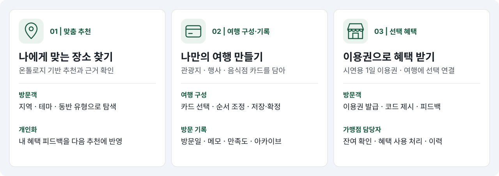
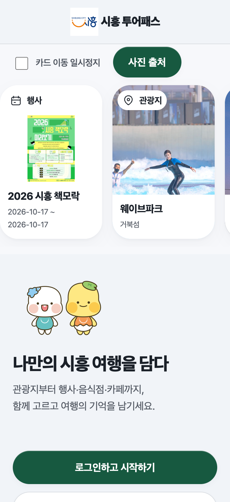
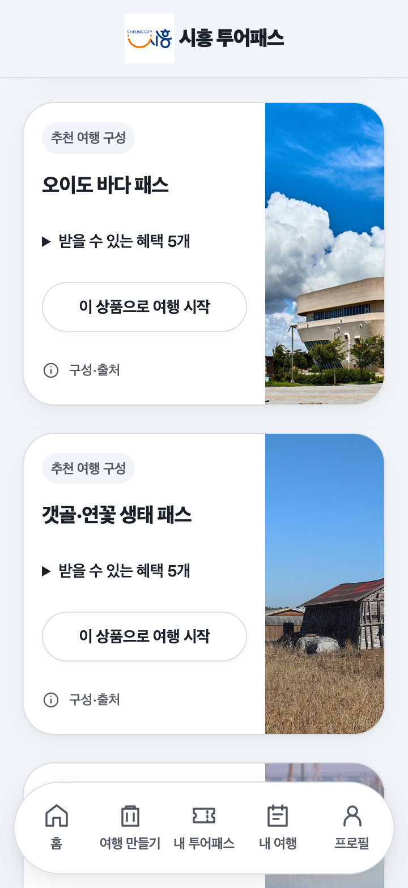
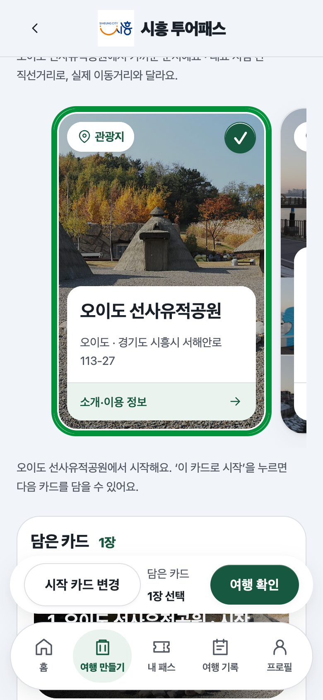
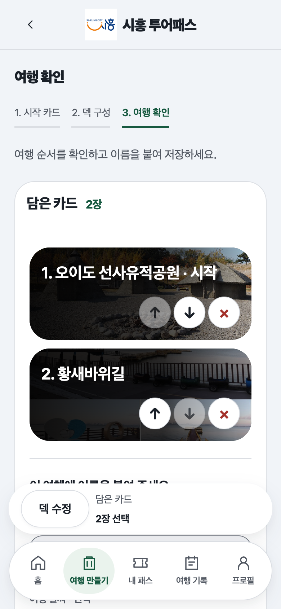
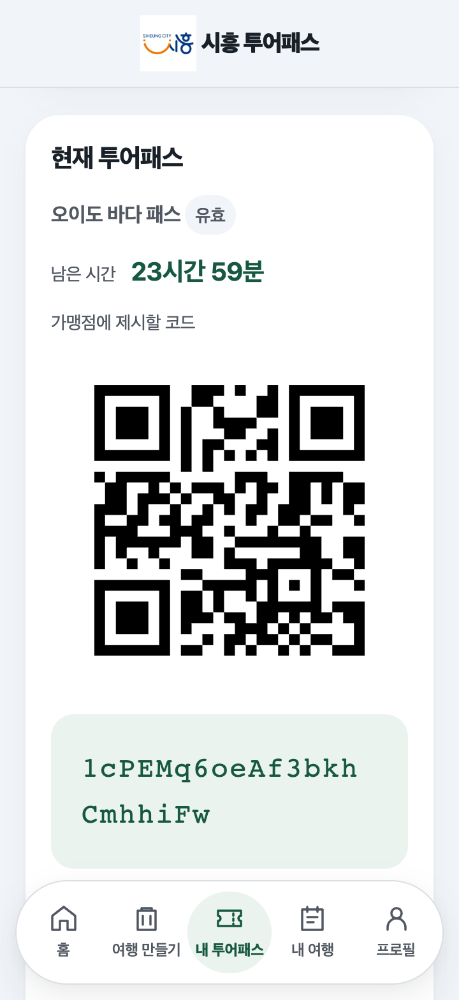
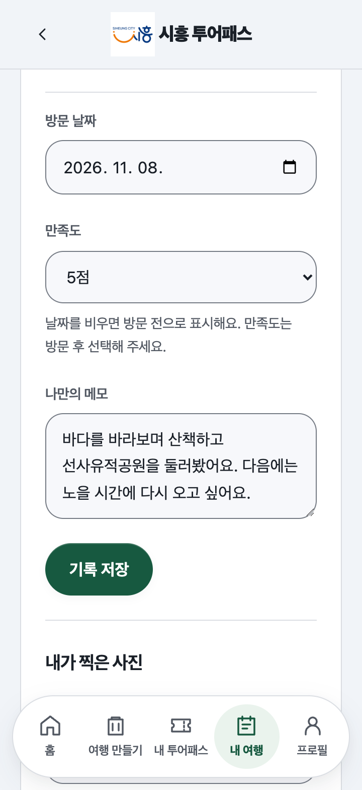
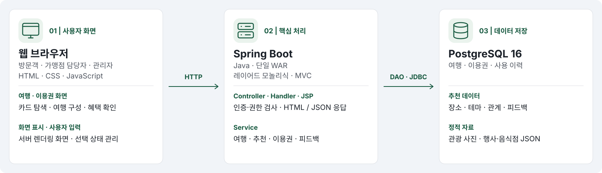

# siheung-tourpass

## 소개

시흥시 관광 장소를 추천하고 혜택 이용 후 피드백을 다음 추천에 반영하는 수업용 웹서비스. 추천 장소를 개인 여행 패스에 담고 방문 기록을 보관한다. 혜택 이용권은 시연용·실제 사용 불가다.

관광지·행사·음식점을 함께 발견하고 여행 후에도 기록을 다시 찾는 흐름을 제공한다. 기획 근거와 효과를 확인할 과제는 [지역 문제와 사용자 검증](docs/presentation/project-validation.md)을 참고한다.



### 주요 화면

방문객의 탐색·여행 구성·혜택 이용·기록 흐름을 담았다. 모바일 360×784 화면을 2배 해상도로 캡처했으며, 이미지를 누르면 원본을 볼 수 있다.

| 서비스 소개 | 상품 선택 | 여행 덱 구성 |
| --- | --- | --- |
| [](docs/assets/landing.png) | [](docs/assets/tourpass-products.png) | [](docs/assets/journey-builder.png) |
| 관광지·행사를 둘러보고 여행 만들기를 시작한다. | 상품의 혜택 장소를 담아 여행을 시작한다. | 주변 후보를 비교하며 원하는 장소를 여행에 추가한다. |

| 여행 확인·구매 진입 | 내 투어패스 | 방문 기록 |
| --- | --- | --- |
| [](docs/assets/journey-review.png) | [](docs/assets/my-tourpass.png) | [](docs/assets/journey-record.png) |
| 이름·날짜와 추천 상품·가격을 확인하고 시연 구매로 이동한다. | 남은 이용 시간을 확인하고 가맹점에 코드를 제시한다. | 방문 날짜·만족도·메모를 남겨 여행을 보관한다. |

## 기술 스택

Spring Boot 3.5·Spring MVC·JSP/JSTL·Java 17·JDBC·PostgreSQL 16 이상·Maven 3.9. 지도는 Leaflet과 OpenStreetMap 타일을 사용한다. 구현 경계는 [구현 계획](docs/tech-specs/01-plan.md#기술-구조)을 따른다.



## 시작하기

Docker를 사용하면 `docker compose up --build`로 앱과 DB를 함께 실행할 수 있다. 명령어와 초기 자료의 차이는 [Docker 실행 안내](docs/tech-specs/04-docker.md)를 따른다. 아래는 직접 설치하는 절차다.

명령은 저장소 루트에서 실행한다.

1. Java 17·Maven 3.9·PostgreSQL 16 이상·Python 3과 PostgreSQL 클라이언트(`createdb`·`psql`)를 준비한다. 빈 DB에 아래 순서로 스키마·시연 계정/혜택·실제 관광 자료를 적재한다. 기존 DB에 초기화 SQL을 재실행하지 않는다.

   ```sh
   createdb -U postgres -E UTF8 siheung_tourpass
   psql -X -v ON_ERROR_STOP=1 -U postgres -d siheung_tourpass < backend/sql/schema.sql
   psql -X -v ON_ERROR_STOP=1 -U postgres -d siheung_tourpass < backend/sql/seed.sql
   python3 backend/scripts/tourism-sql.py --replace-demo > /tmp/siheung-tourism.sql
   psql -X -v ON_ERROR_STOP=1 -U postgres -d siheung_tourpass < /tmp/siheung-tourism.sql
   python3 backend/scripts/tourpass-sql.py > /tmp/siheung-tourpass.sql
   psql -X -v ON_ERROR_STOP=1 -U postgres -d siheung_tourpass < /tmp/siheung-tourpass.sql
   ```

   기존 DB는 초기화 SQL 대신 백업 후 [마이그레이션 디렉터리](backend/sql/migrations)의 SQL 중 아직 적용하지 않은 파일만 번호 순서대로 한 번씩 적용한다. 각 파일의 적용 명령은 `psql -X -v ON_ERROR_STOP=1 -U postgres -d siheung_tourpass < 파일경로`다. 신규 스키마에는 이미 포함되어 있다. 새 테이블이 추가되면 2단계의 앱 계정 권한 부여도 다시 실행한다.
2. DB에서 앱 전용 계정을 만들고 테이블의 SELECT·INSERT·UPDATE·DELETE와 identity 시퀀스의 USAGE 권한을 부여한다.

   ```sql
   CREATE ROLE tourpass LOGIN;
   -- psql에서 \password tourpass로 비밀번호를 설정한다.
   GRANT CONNECT ON DATABASE siheung_tourpass TO tourpass;
   GRANT USAGE ON SCHEMA public TO tourpass;
   GRANT SELECT, INSERT, UPDATE, DELETE ON ALL TABLES IN SCHEMA public TO tourpass;
   GRANT USAGE ON ALL SEQUENCES IN SCHEMA public TO tourpass;
   ```

   앱 실행 환경에 연결 정보를 설정한다. 비밀번호는 로컬 환경으로만 전달한다.

   ```sh
   export TOURPASS_DB_URL='jdbc:postgresql://127.0.0.1:5432/siheung_tourpass'
   export TOURPASS_DB_USER='tourpass'
   read -r -s TOURPASS_DB_PASSWORD
   export TOURPASS_DB_PASSWORD
   ```

   외부 Tomcat 배포에서 환경 변수가 없으면 Tomcat JNDI `java:comp/env/jdbc/TourpassDB` DataSource를 사용한다. JNDI 방식에서는 PostgreSQL JDBC 드라이버를 Tomcat `lib`에 제공한다.
3. 같은 환경에서 빌드하고 실행한다. JSP 때문에 JAR 대신 WAR를 사용한다.

   ```sh
   mvn -f backend/pom.xml clean package
   java -jar backend/target/siheung-tourpass.war
   ```

   외부 Tomcat 10.1을 사용하는 경우 WAR를 `webapps`에 복사하고 `bin/catalina.sh run`으로 실행한다. 두 실행 방식 중 하나를 사용한다. 포트는 내장 실행 시 `--server.port=8081`로 변경할 수 있다.

실제 관광 자료의 승인·기존 DB 전환은 [데이터 안내](docs/data-collection/tourism-data.md#적재)를 따른다.

### 카카오 로그인 설정

[카카오 로그인 REST API 안내](https://developers.kakao.com/docs/ko/kakaologin/rest-api)에 따라 카카오 앱에서 로그인을 활성화하고 Redirect URI를 등록한다. 로컬 기본 주소는 `http://localhost:8080/siheung-tourpass/login/kakao/callback`이다. 배포 시에는 실제 HTTPS 주소를 등록하고 아래 값도 동일하게 설정한다. 회원번호만 사용하므로 이메일·프로필 동의 항목은 필요하지 않다.

앱 실행 환경에 `TOURPASS_KAKAO_CLIENT_ID`(REST API 키), `TOURPASS_KAKAO_REDIRECT_URI`(등록한 전체 콜백 주소)를 설정한다. Client Secret이 활성화되어 있으면 `TOURPASS_KAKAO_CLIENT_SECRET`도 설정한다. 비밀값은 저장소·채팅에 올리지 않고 로컬 환경으로만 전달한다. 설정 후 앱을 재시작한다. 키 또는 콜백 주소가 없으면 로그인 버튼은 준비 중으로 표시된다. 기존 DB에는 시작하기의 절차에 따라 미적용 마이그레이션을 적용한다.

## 사용 방법

화면은 `http://localhost:8080/siheung-tourpass/`, API는 같은 주소의 `/api/v1`. 시연 계정 `visitor`, `visitor2`, `staff-a`, `staff-b`, `admin`의 초기 암호는 모두 `DemoPass!2026`이다.

| 작업 | 사용 흐름 |
| --- | --- |
| 여행 구성 | 여행 만들기 → 전체 상품에서 상품 선택 또는 직접 카드 고르기 → 덱 구성 → 여행 확인 → 이름·날짜 입력 → 임시 저장 또는 제작 확정 |
| 공개 탐색 | 여행 카드 둘러보기 → 검색·종류·지역·행사 날짜로 탐색 → 카드 상세·공식 안내 확인. 저장 시 방문객 로그인 |
| 여행 기록 | 내 투어패스 → 진행 중인 여행 → 방문 기록 → 사용 완료 → 내 여행에서 사진 업로드·교체·삭제 → 사용 완료 여행의 포토카드 인쇄 |
| 투어패스 구매·이용 | 여행 만들기 → 여행 확인의 `확정하고 투어패스 구매` → 시연 결제 → 여행 카드의 혜택 배지 확인 → 내 투어패스 코드를 담당자에게 제시 → 사용 이력에서 피드백 |
| 관광지 평가 | 관광지 상세 → 만족도·선택 의견 저장·수정·삭제 |
| 가맹점 담당자 | 코드 입력 → 배정 혜택·잔여 확인 → 사용 확인 → 결과·이력 조회 |
| 관리자 | 관광·혜택 자료 관리·검토, 통계 조회, 사유 입력 후 이용권 취소. 관광 관리 → 카드 상세 → 카드 출력 → 설정 → 미리보기·인쇄 |
| 카카오 로그인 | 로그인 → 카카오톡으로 로그인 → 카카오 동의 → 방문객 홈. 처음 로그인하면 별도 방문객 계정을 생성하며 기존 여행은 기존 계정에 유지된다. 서비스 로그아웃은 카카오 계정 로그아웃과 별개다. |
| 계정 | 프로필 → 계정 정보·화면 설정·로그아웃 |

초기 자료의 담기 조건은 [여행 구성](docs/func-specs/02-visitor.md#담기와-보존), 추천 승인 절차는 [데이터 적재](docs/data-collection/tourism-data.md#적재)를 따른다.

포토카드는 A4 세로, 배율 100%, 머리글/바닥글을 끄고 출력한다. QR에는 서비스 경로까지 포함한 접속 주소를 설정하고 휴대전화로 열리는지 확인한다. 사진 이용 범위는 [포토카드 정책](docs/func-specs/04-admin.md#카드-출력)을 따른다.

### API

서버 실행 후 [Scalar](http://localhost:8080/siheung-tourpass/api-docs)에서 요청·응답을 확인한다. API 탐색은 `GET /api/v1/`의 응답 링크에서 시작한다. 보호된 요청은 Scalar 인증 설정에 시연 계정을 입력하고, 변경 요청에는 `X-CSRF-Token: api`를 전달한다. 로컬 시연 외에는 Basic 인증을 HTTPS로 전송한다.

Bruno에서 [컬렉션](backend/bruno)을 열고 `Local` 환경을 선택한다. `Auth / Index`와 역할별 `Select` 요청을 실행하면 인증·CSRF 헤더가 자동 적용된다. 변경 요청은 [별도 테스트 DB](#테스트)에서 개별 실행한다. 역할 전환 순서는 컬렉션의 Docs에 있다. API 변경 시 [명세 원본](frontend/assets/api-docs/openapi.yaml)을 갱신하고 [명세 검사](backend/tests/python/openapi_check.py)로 서버와 비교한다.

## 테스트

[GitHub Actions](.github/workflows/ci.yml)가 push·PR마다 빌드·자동 검사를 실행한다. 자동 검사 명령·초기화 순서는 워크플로를 원본으로 사용한다. `api`·`web`·`tourism` 작업의 초기 자료가 다르며, DB를 변경하므로 시연·보관용 DB와 분리한다. 검증 범위는 [구현 계획](docs/tech-specs/01-plan.md#검증-전략), 최종 판정은 [완료 기준](docs/func-specs/01-common.md#완료-기준)을 따른다.

브라우저 검사는 Node.js·Playwright·Chrome과 별도 테스트 서버의 시연 계정이 필요하다. 외부 경로의 Playwright는 `PLAYWRIGHT_MODULE`에 모듈 경로를 지정한다. 아래 URL은 테스트 서버에 맞게 바꾼다.

| 검사 | 명령 |
| --- | --- |
| 카드 탐색·선택·저장 | `node backend/tests/browser/cards_browser_check.cjs http://localhost:8080/siheung-tourpass` |
| 여행 사진 업로드·교체·삭제·소유권 | `node backend/tests/browser/journey_photos_check.cjs http://localhost:8080/siheung-tourpass` |
| 관리자·포토카드 출력 | `node backend/tests/browser/admin_browser_check.cjs http://localhost:8080/siheung-tourpass` |

## 관련 문서

기능 명세·요구사항은 `docs/func-specs/`, 기술 명세·구현 계획은 `docs/tech-specs/`에서 관리합니다.

문서 관리 원칙은 [작업 지침](AGENTS.md)을 따른다. 아래에서 변경할 내용의 담당 문서를 찾는다.

### 요구사항·구조·화면

| 문서 | 담당 내용 |
| --- | --- |
| [기능 명세 안내](docs/func-specs/README.md) | 공통·역할별 문서 읽는 순서 |
| [공통 요구사항](docs/func-specs/01-common.md) | 범위·공통 인증·이용권 정책·API 계약·완료 기준 |
| [방문객 요구사항](docs/func-specs/02-visitor.md) | 공개 탐색·이용권 발급/조회·여행·추천·피드백·사진·방문 기록 |
| [가맹점 담당자 요구사항](docs/func-specs/03-merchant.md) | 혜택 확인·사용 권한 |
| [관리자 요구사항](docs/func-specs/04-admin.md) | 자료 관리·검토·피드백 통계·카드 출력 |
| [구현 계획](docs/tech-specs/01-plan.md) | 소스 구조·구현 경계·검증 전략·남은 작업 |
| [디자인 기준](docs/tech-specs/02-design.md) | 역할별 메뉴·화면 배치·조작·상태·접근성 |
| [추천 모델](docs/tech-specs/03-tourism-semantics.md) | 개념 계층·추천 점수·정렬·추론 경계 |

### 실행·검증·협업

| 문서 | 담당 내용 |
| --- | --- |
| [Docker 실행 안내](docs/tech-specs/04-docker.md) | Docker 로컬 실행·변경 반영·초기 자료 |
| [작업 지침](AGENTS.md) | 문서와 코드 변경 원칙 |
| [이슈·PR 작성 규칙](docs/collaboration.md) | 이슈·PR 제목과 본문 작성 방법 |

### 발표·사용자 검증

| 문서 | 담당 내용 |
| --- | --- |
| [최종 발표 준비 기준](docs/presentation/final-presentation.md) | 발표·제출 조건·심사기준·자료 구성·근거 준비·제출 점검 |
| [지역 문제와 사용자 검증](docs/presentation/project-validation.md) | 지역 문제 가설·기능 연결·역할별 검증 과제·기록 방법 |
| [거북섬 투어패스 검토 과제](docs/presentation/시흥%20거북섬%20투어패스%20도입을%20위한%20검토%20과제.pdf) | 투어패스 도입 검토 참고 자료 |

### 데이터 수집·검토

| 문서 | 담당 내용 |
| --- | --- |
| [데이터 수집 공통 기준](docs/data-collection/common.md) | 공통 출처·좌표·이미지 기준 |
| [관광 데이터](docs/data-collection/tourism-data.md) | 관광 적재·승인·운영 조건 검토·사진 배포 |
| [행사 데이터](docs/data-collection/events-data.md) | 행사 일정·장소 연결·이미지·배포 조건 |
| [음식점 데이터](docs/data-collection/dining-data.md) | 공식 지정 업소의 공개·분류·이미지·배포 조건 |
| [음식점 이미지 조사](docs/data-collection/dining-images.md) | 미등록 사진 후보 근거·미확보 사유·재개 조건 |
| [투어패스 시연 자료](docs/data-collection/tourpass-data.md) | 가상 가맹점·상품·가격 자료의 성격과 적재 |
