# 핵심 유저 플로우 — 모바일

[요구사항](../01-func/README.md) · [디자인 기준](../02-uxui/01-design.md) · [다른 화면 버전](03-user-flows-desktop.md)

## 촬영·검증 상태

2026-11-13 로컬 Chrome에서 실제 관광·가상 혜택 자료를 적재한 별도 검증 DB로 촬영한 24장이다. 화면 크기는 `390×844` CSS px다. 구매·혜택 사용·피드백·여행 완료 확인·방문 기록 저장과 오류 복구 검사가 통과했다. 연한 초록 블록은 코드·QR 마스킹이다.

## 1. 탐색·로그인·여행 구성

| 진입·탐색 | 로그인·상품 선택 |
| --- | --- |
| [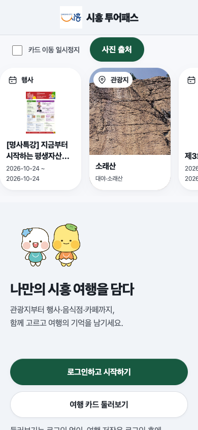](../assets/user-flows/mobile/01-landing.png) 소개에서 공개 탐색·로그인으로 진입한다. | [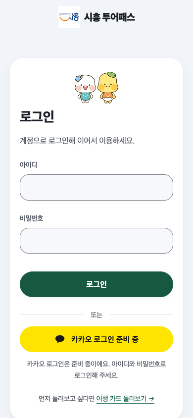](../assets/user-flows/mobile/03-login.png) 방문객 계정으로 로그인한다. |
| [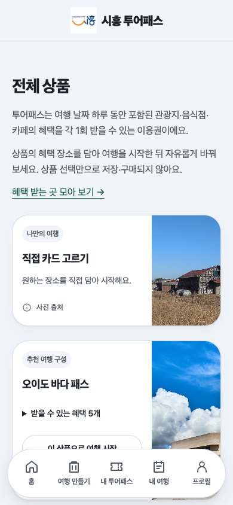](../assets/user-flows/mobile/04-products.png) 포함 장소를 비교하고 `이 상품으로 여행 시작`을 누른다. | [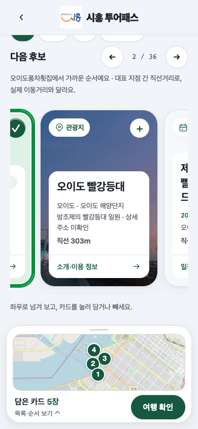](../assets/user-flows/mobile/05-builder.png) 포함 장소가 담긴 상태에서 카드를 더하거나 뺀다. |
| [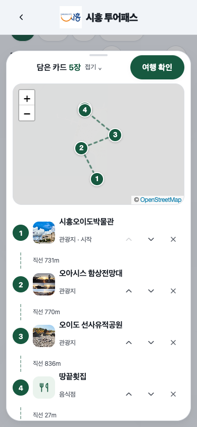](../assets/user-flows/mobile/06-selected-map.png) 하단 시트를 펼쳐 위치·순서를 확인한다. | [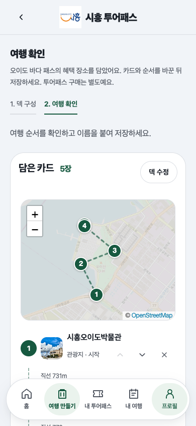](../assets/user-flows/mobile/07-review.png) 담은 카드의 지도와 방문 순서를 확인한다. |

| 여행 정보·저장 선택 | 다음 행동 |
| --- | --- |
| [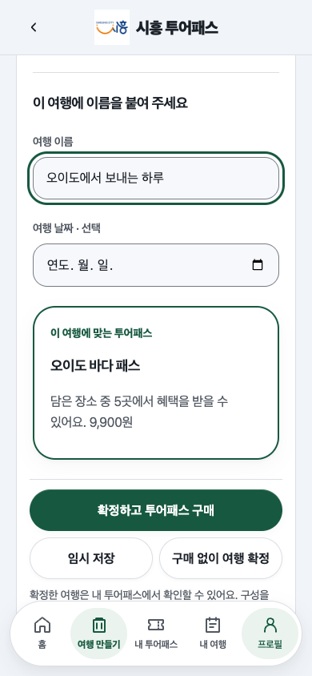](../assets/user-flows/mobile/07b-review-actions.png) | 이름·날짜를 정하고 임시 저장·구매 없이 확정·확정 후 구매를 선택한다. |

## 2. 구매·코드 제시·담당자 혜택 사용

| 구매·코드 제시 | 담당자 확인·사용 결과 |
| --- | --- |
| [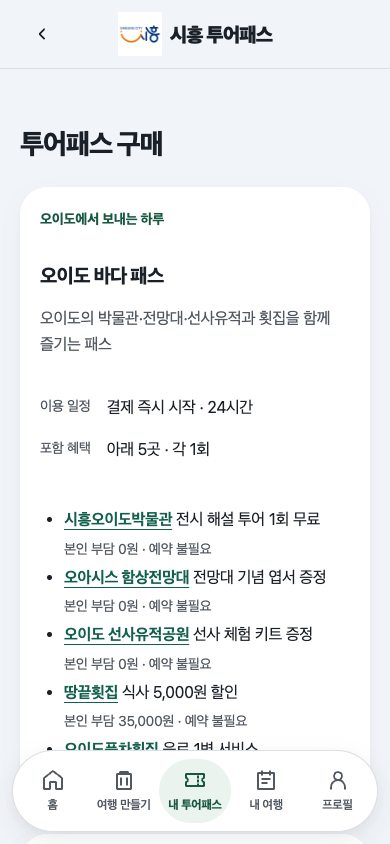](../assets/user-flows/mobile/08-checkout.png) 포함 장소의 본인 부담·예약 조건을 확인한다. | [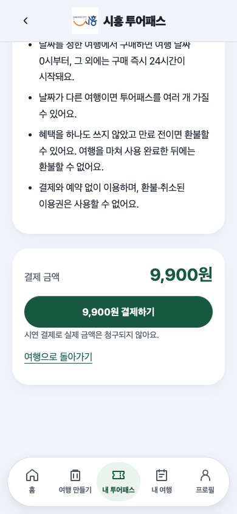](../assets/user-flows/mobile/08b-checkout-payment.png) 최종 금액을 확인하고 결제한다. |
| [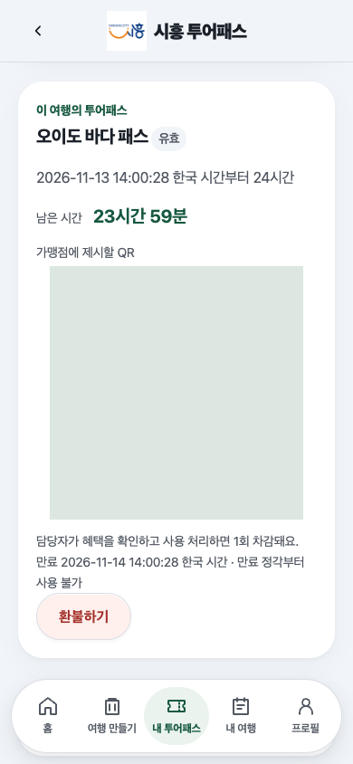](../assets/user-flows/mobile/09-pass-code.png) 구매한 여행의 QR을 제시한다. | [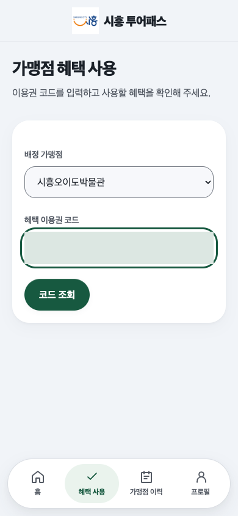](../assets/user-flows/mobile/10-staff-lookup.png) 배정 가맹점을 고르고 코드를 입력한다. |
| [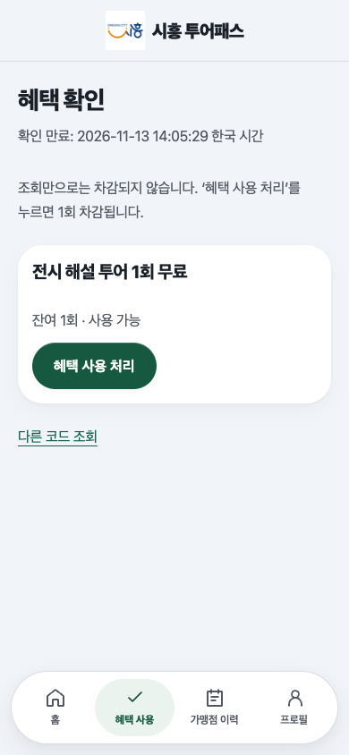](../assets/user-flows/mobile/11-staff-confirm.png) 미차감 상태에서 잔여·가능 여부를 확인하고 사용 처리한다. | [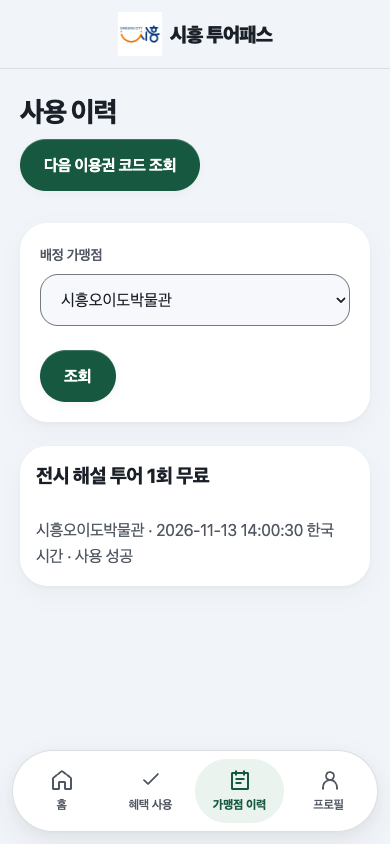](../assets/user-flows/mobile/12-staff-history.png) 사용 이력을 확인하고 다음 코드 조회로 이동한다. |
| [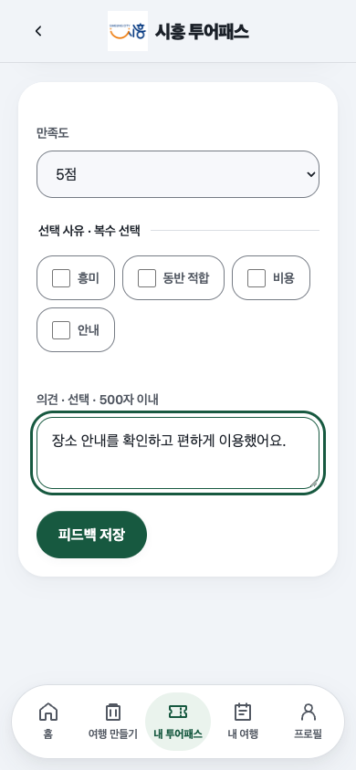](../assets/user-flows/mobile/13-feedback.png) 사용 이력에서 평가를 남긴다. | 뒤로가기 시 혜택 사용 이력으로 돌아간다. |

## 3. 여행 완료·방문 기록·포토카드

| 완료 전 확인 | 완료 후 기록 |
| --- | --- |
| [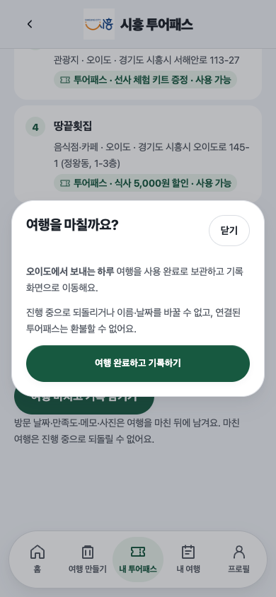](../assets/user-flows/mobile/14-finish-confirm.png) 변경·환불 제한을 확인하고 완료한다. | [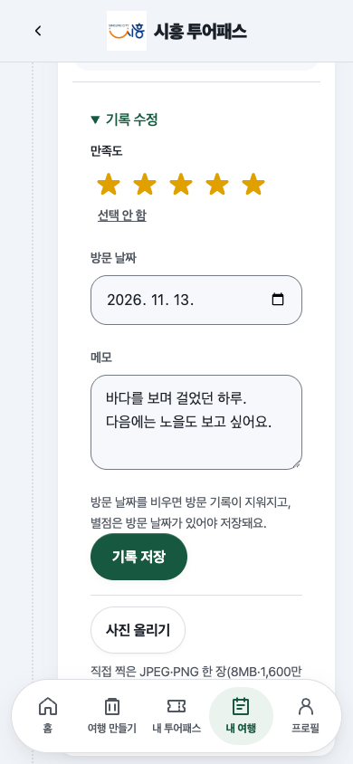](../assets/user-flows/mobile/15-travel-record.png) 오늘까지의 방문 날짜·별점·메모를 입력한다. |
| [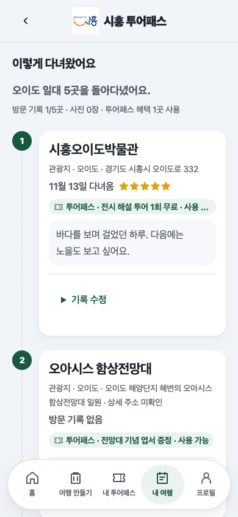](../assets/user-flows/mobile/15b-record-saved.png) 저장된 방문 날짜·별점·메모를 확인한다. | 기록 수정에서 다시 편집할 수 있다. |
| [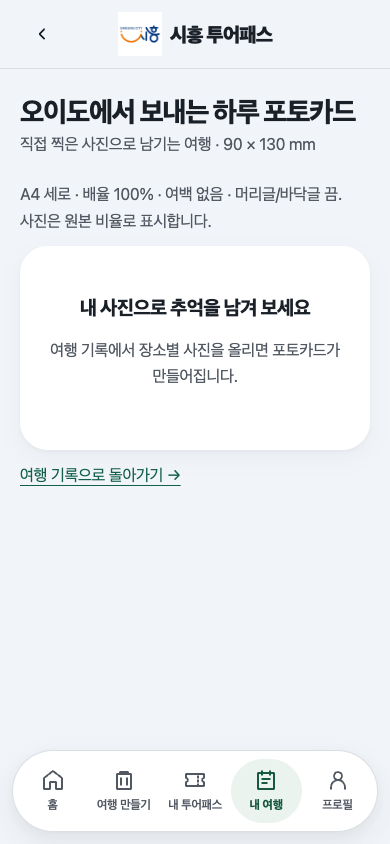](../assets/user-flows/mobile/16-photocard-empty.png) 사진이 없으면 기록 업로드로 안내한다. | 사진 업로드·교체·삭제·권한은 [별도 브라우저 검사](../../backend/tests/browser/journey_photos_check.cjs) 대상이며 이번 촬영에서는 재검사하지 않았다. |

## 4. 관리자 관광 카드 출력

| 대상·설정 | 출력 미리보기 |
| --- | --- |
| [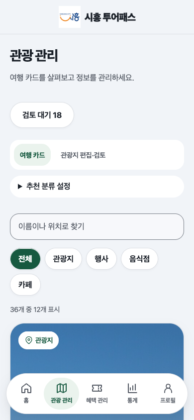](../assets/user-flows/mobile/17-admin-catalog.png) 종류·검색 조건으로 카드를 고른다. | [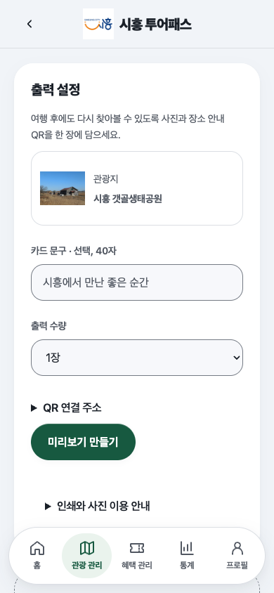](../assets/user-flows/mobile/18-admin-print-settings.png) 선택한 카드와 출력 조건을 설정한다. |
| [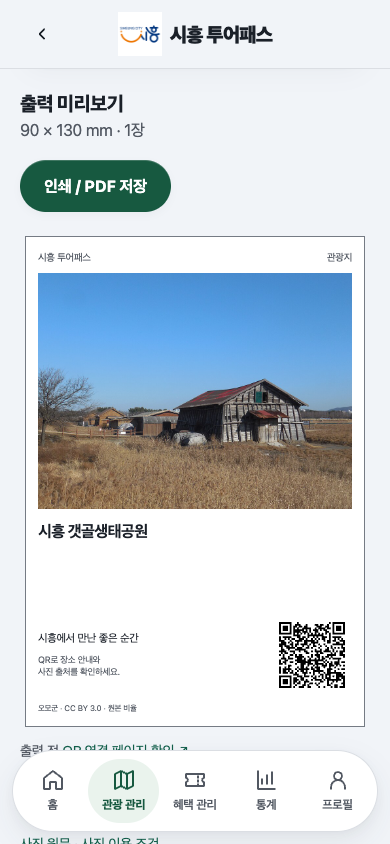](../assets/user-flows/mobile/19-admin-print-preview.png) 출력 형태를 확인한다. | A4 인쇄 조건은 [카드 출력](../01-func/04-admin.md#카드-출력)을 따른다. |

## 5. 빈 결과·오류 복구

| 상황 | 다음 행동 |
| --- | --- |
| [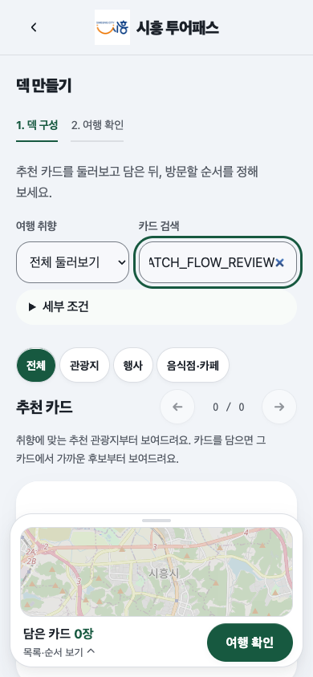](../assets/user-flows/mobile/02-empty-search.png) | `전체 카드 보기`로 검색 조건을 초기화한다. |
| [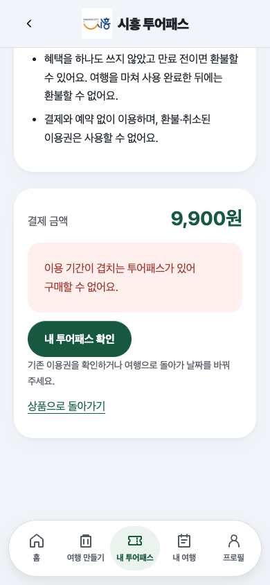](../assets/user-flows/mobile/21-checkout-conflict.png) | 결제 차단 사유와 `내 투어패스 확인`·여행 복귀 링크를 제공한다. |
| [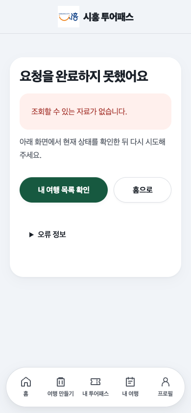](../assets/user-flows/mobile/22-missing-trip.png) | 여행 목록으로 이동해 다시 찾는다. |

## 검증·재촬영

[흐름 검사](../../backend/tests/browser/user_flows_check.cjs)는 화면 버전별 새 검증 DB에서 구매·사용·여행 완료·기록 저장을 검증하고 캡처한다. 실행은 [README 테스트](../../README.md#테스트)를 따른다. 참여자 검증은 [사용자 검증 절차](../presentation/project-validation.md#검증-절차)를 따른다.
