# 핵심 유저 플로우 — 화면 캡처와 UX 검토

2026-11-11 기준 로컬 Chrome에서 실제 조작한 화면이다. 모바일 390×844, 관리자 데스크톱 1280×900으로 총 25장을 캡처했다. 긴 화면은 스크롤해 주요 영역별로 나눠 촬영했다. 고정 메뉴가 본문 중간에 끼는 전체 페이지 캡처는 사용하지 않는다. 연한 초록색 블록은 코드·QR·코드 입력값을 가린 영역이다. 별도 검증 DB에 실제 관광 자료와 가상 혜택 상품을 적재했으며, 이 캡처는 실제 제휴·결제나 자료 최신성 검토의 증거가 아니다.

정책은 [공통·역할별 요구사항](../func-specs/README.md), 배치·조작은 [디자인 기준](02-design.md)을 따른다. 이 문서는 흐름과 확인한 화면을 담당한다.

## 검토 후 반영

| 흐름에서 발견한 문제 | 반영한 UX/UI |
| --- | --- |
| 진행 중 여행을 한 번 누르면 되돌릴 수 없이 완료 | 기존 팝오버 양식으로 여행 이름·변경 제한·환불 제한을 확인한 뒤 완료. 닫기·Esc는 상태 유지 |
| 구매 직전 혜택 목록에서 추가 부담·예약 조건을 비교하기 어려움 | 각 장소의 혜택 아래 본인 부담액·예약 조건 표시 |
| JavaScript 없는 여행 구성도 덱 준비를 기다리며 화면을 숨김 | 스크립트 사용 환경에서만 초기 덱 전환 대기를 적용, 비활성 환경은 목록을 즉시 표시 |
| 숨긴 별점·사진 입력에 일반 입력창 너비가 적용돼 캡처 영역이 늘어남 | 공통 입력 스타일에서 접근성용 숨긴 입력을 제외 |
| 기록 화면을 주소 끝의 위치 표시 없이 열면 JavaScript 오류 발생 | 장소 ID로 찾아 저장 후 펼침 동작 유지, 일반 진입의 빈 위치도 처리 |
| 기록에 미래 방문일을 입력한 뒤 서버에서야 거절 | 한국 날짜 기준 오늘까지 날짜 선택 허용. 서버 검증도 유지 |
| 담당자 사용 처리 후 다음 고객 조회 경로가 하단 메뉴에만 있음 | 사용 이력 상단에 `다음 이용권 코드 조회` 제공 |
| 피드백 뒤로가기가 사용 이력이 아닌 내 투어패스로 이동 | 피드백 화면 뒤로가기를 혜택 사용 이력으로 연결 |
| 홈·이용 방법의 기록 안내가 현재 조작 순서와 다름 | 진행 중 여행은 코드 확인, 기록은 여행 완료 후라는 안내로 정리 |

## 1. 탐색·로그인·여행 구성

서비스 소개 → 공개 카드 탐색 → 로그인 → 전체 상품 → 상품으로 여행 시작(또는 직접 카드 고르기) → 덱에서 카드 선택 → 지도·순서 확인 → 여행 확인.

| 진입·탐색 | 로그인·상품 선택 |
| --- | --- |
| [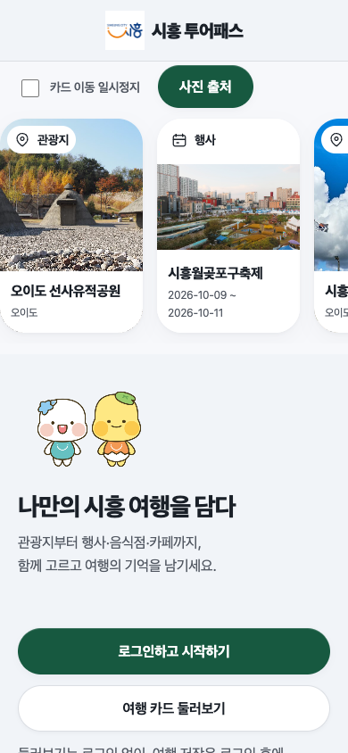](../assets/user-flows/01-landing.png) 소개에서 공개 탐색·로그인으로 진입한다. | [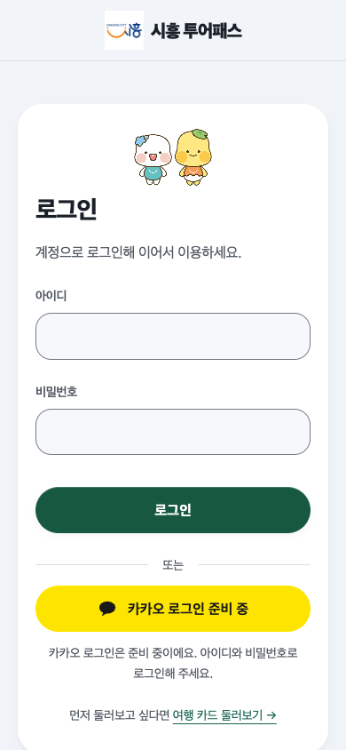](../assets/user-flows/03-login.png) 방문객 계정으로 로그인한다. |
| [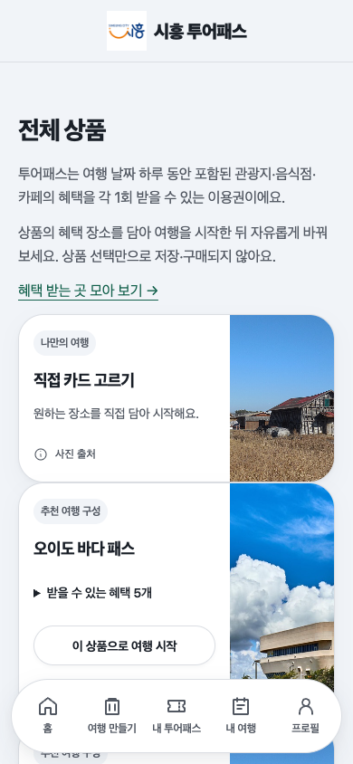](../assets/user-flows/04-products.png) 포함 장소를 비교하고 `이 상품으로 여행 시작`을 누른다. | [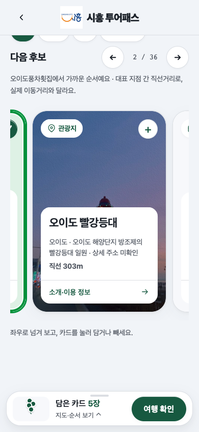](../assets/user-flows/05-builder.png) 포함 장소가 담긴 상태에서 카드를 더하거나 뺀다. |
| [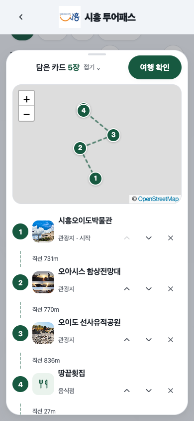](../assets/user-flows/06-selected-map.png) 하단 시트를 펼쳐 위치·순서를 확인한다. | [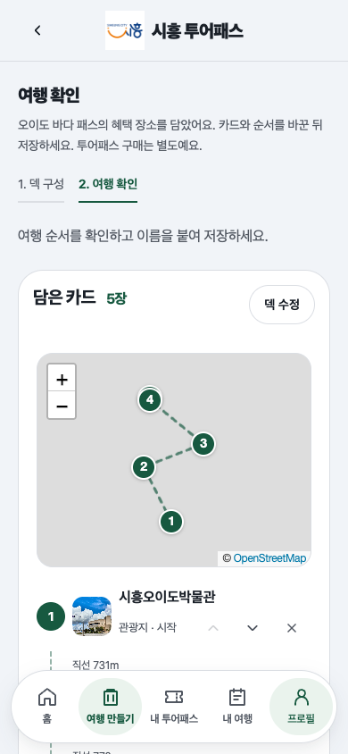](../assets/user-flows/07-review.png) 담은 카드의 지도와 방문 순서를 확인한다. |

| 여행 정보·저장 선택 | 다음 행동 |
| --- | --- |
| [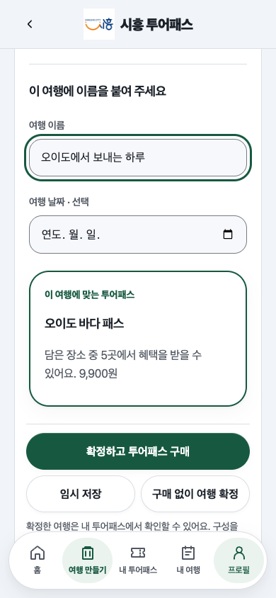](../assets/user-flows/07b-review-actions.png) | 이름·날짜를 정하고 임시 저장·구매 없이 확정·확정 후 구매를 선택한다. |

## 2. 구매·코드 제시·담당자 혜택 사용

여행 확인의 `확정하고 투어패스 구매` → 일정·혜택·본인 부담·예약 조건·총액 확인 → 결제 → 여행 상세 코드 제시 → 담당자가 배정 가맹점·코드 조회 → 잔여 확인 → 혜택 사용 처리 → 사용 이력.

| 구매·코드 제시 | 담당자 확인·사용 결과 |
| --- | --- |
| [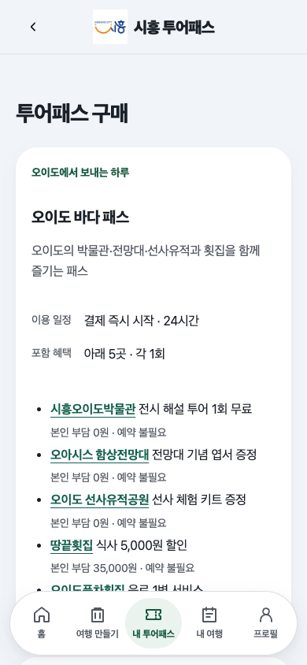](../assets/user-flows/08-checkout.png) 포함 장소의 본인 부담과 예약 조건을 살펴본다. | [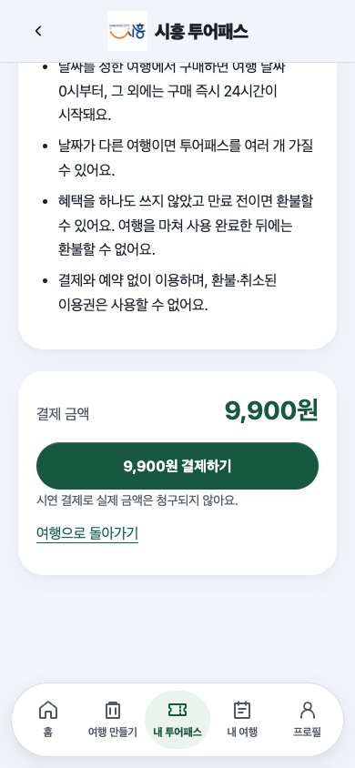](../assets/user-flows/08b-checkout-payment.png) 구매 전 확인을 읽고 최종 금액을 확인한다. |
| [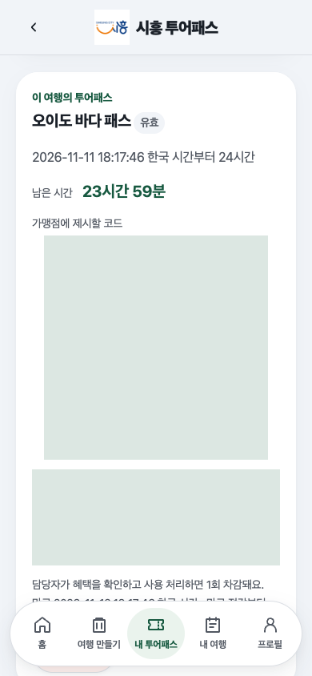](../assets/user-flows/09-pass-code.png) 구매한 여행의 코드를 제시한다. 연한 초록색은 코드·QR을 가린 영역이다. | [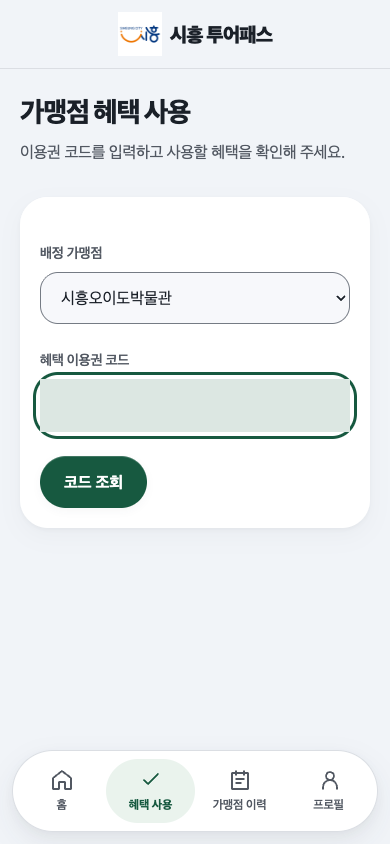](../assets/user-flows/10-staff-lookup.png) 배정 가맹점을 고르고 제시받은 코드를 입력한다. |
| [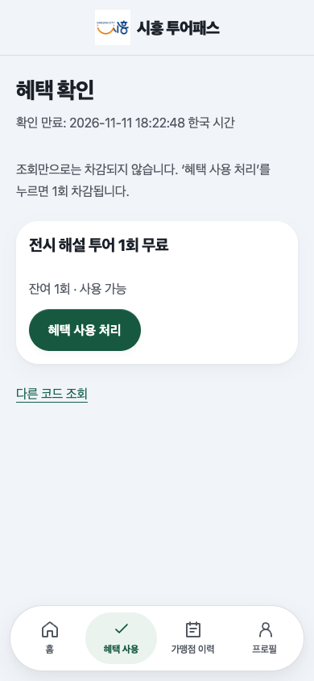](../assets/user-flows/11-staff-confirm.png) 조회 단계에서는 차감되지 않는다. 잔여와 사용 가능 여부를 확인하고 처리한다. | [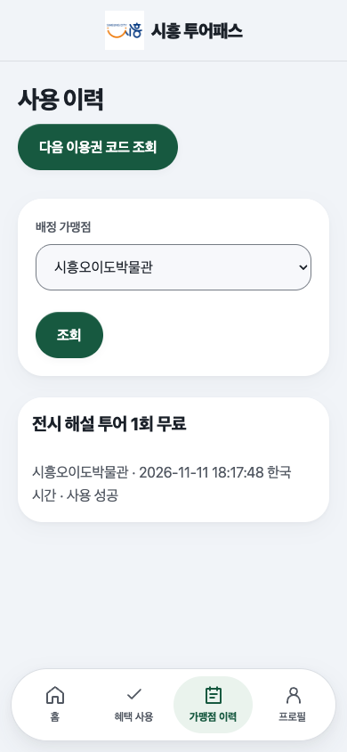](../assets/user-flows/12-staff-history.png) 실제로 사용 처리한 가맹점의 이력을 조회한다. 다음 이용권 조회로 이어갈 수 있다. |
| [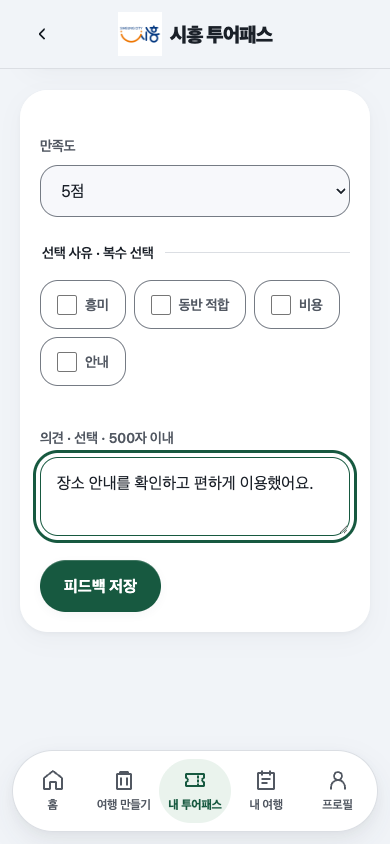](../assets/user-flows/13-feedback.png) 방문객은 혜택 사용 이력에서 평가를 남긴다. | 피드백 화면의 뒤로가기는 혜택 사용 이력으로 돌아간다. |

## 3. 여행 완료·방문 기록·포토카드

진행 중 여행의 `여행 마치고 기록 남기기` → 확인창 → `여행 완료하고 기록하기` → 장소의 `기록 남기기` → 별점·방문 날짜·메모 저장 → 사진 업로드 후 포토카드.

| 완료 전 확인 | 완료 후 기록 |
| --- | --- |
| [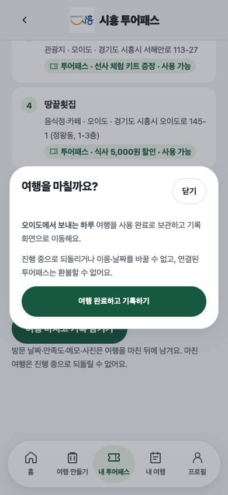](../assets/user-flows/14-finish-confirm.png) 되돌릴 수 없음과 이름·날짜 변경 및 환불 제한을 확인한다. 닫으면 여행을 계속할 수 있다. | [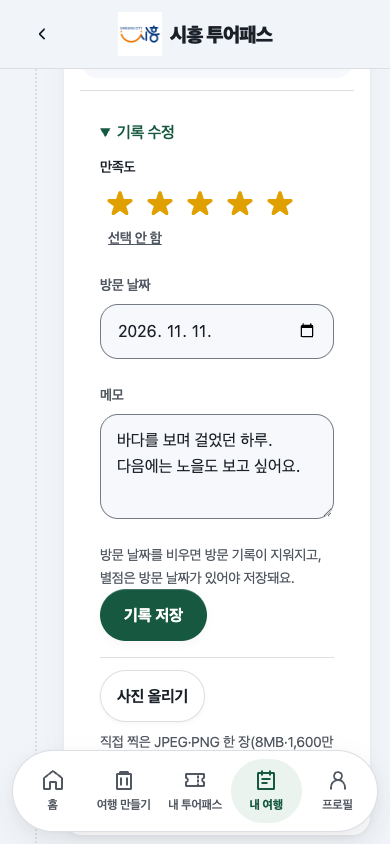](../assets/user-flows/15-travel-record.png) 미래 날짜는 선택할 수 없다. 별점을 먼저 고르면 방문 날짜를 채우고 저장 후 같은 장소를 펼친다. |
| [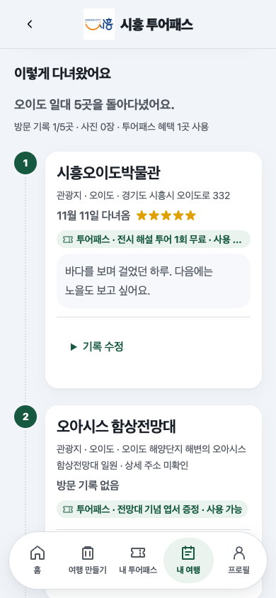](../assets/user-flows/15b-record-saved.png) 입력을 접고 저장된 방문 날짜·별점·메모를 확인한다. | 기록 수정에서 다시 입력을 펼칠 수 있다. |
| [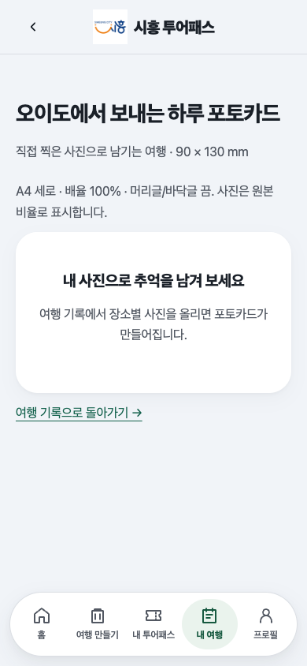](../assets/user-flows/16-photocard-empty.png) 사진이 없으면 기록 화면으로 돌아가 사진을 올리도록 안내한다. | 사진 업로드·교체·삭제·출력 권한은 [기존 브라우저 검사](../../backend/tests/browser/journey_photos_check.cjs)가 담당한다. 이 캡처 흐름은 사진 미등록 복구까지 확인했다. |

## 4. 관리자 관광 카드 출력

관광 관리 → 카드 선택 → `카드 출력` → 출력 설정 → `미리보기 만들기` → 미리보기·인쇄.

| 대상·설정 | 출력 미리보기 |
| --- | --- |
| [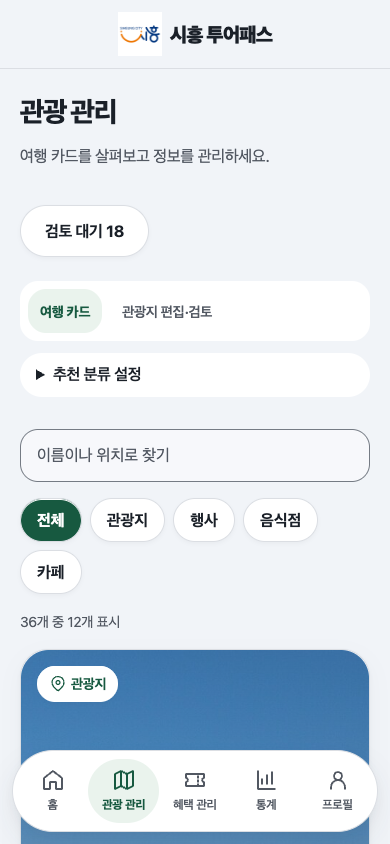](../assets/user-flows/17-admin-catalog.png) 목록 상단의 종류·검색 조건을 확인한다. 전체 목록을 길게 캡처하지 않는다. | [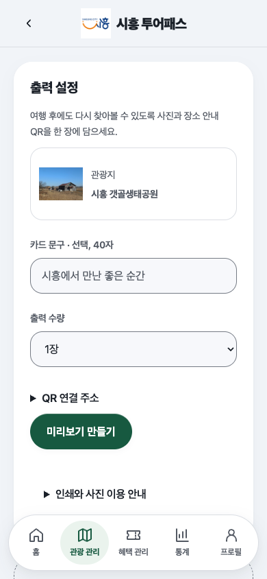](../assets/user-flows/18-admin-print-settings.png) 선택한 카드와 출력 조건을 확인한다. |
| [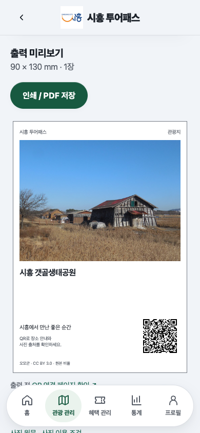](../assets/user-flows/19-admin-print-preview.png) 미리보기에서 문구·출력 형태를 확인한다. | [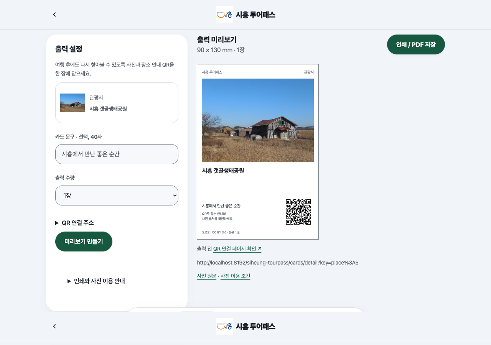](../assets/user-flows/20-admin-desktop.png) 넓은 화면에서도 같은 설정·미리보기 흐름을 사용한다. |

## 5. 빈 결과·오류 복구

| 상황 | 다음 행동 |
| --- | --- |
| [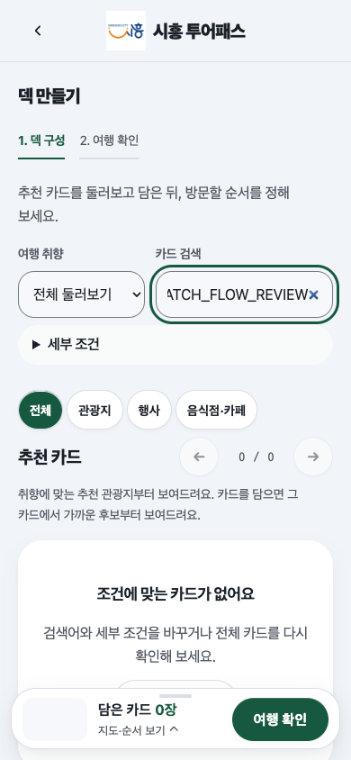](../assets/user-flows/02-empty-search.png) | `전체 카드 보기`로 검색 조건을 초기화한다. |
| [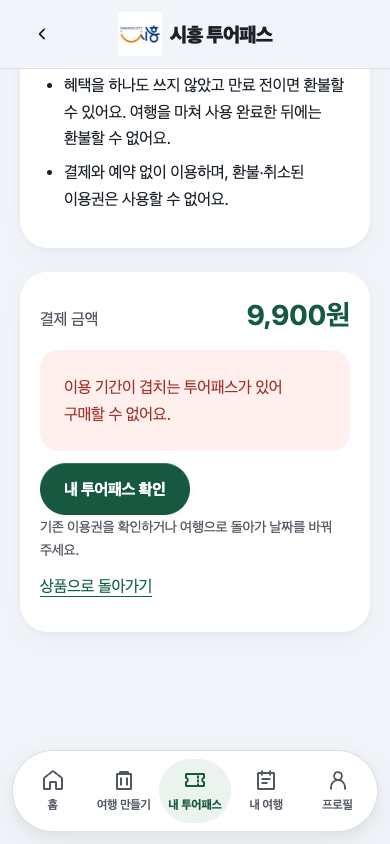](../assets/user-flows/21-checkout-conflict.png) | 결제 버튼 대신 이유와 `내 투어패스 확인`을 제공한다. 여행으로 돌아가 날짜를 바꿀 수도 있다. |
| [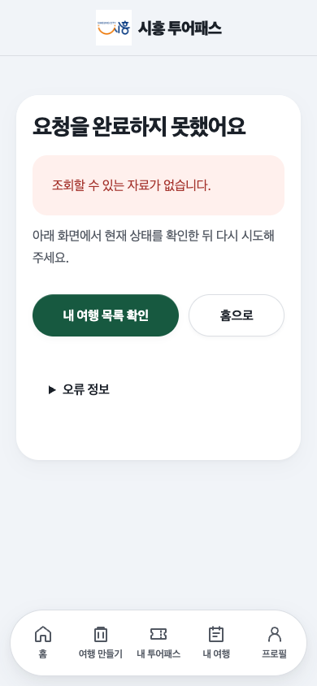](../assets/user-flows/22-missing-trip.png) | 여행 목록에서 현재 여행을 다시 찾는다. |

## 검증·재촬영

[흐름 검사](../../backend/tests/browser/user_flows_check.cjs)는 화면 조작으로 구매·차감·피드백 저장·완료 확인의 취소/실행·날짜 제한·기록 저장·관리자 출력 미리보기를 확인하고 캡처한다. 새 검증 DB에 실제 관광 자료와 혜택 상품을 적재한 서버에서만 실행한다. 구매·사용 완료 기록이 남으므로 재실행할 때도 새 검증 DB를 사용한다. 준비·환경·명령은 [README 테스트](../../README.md#테스트)를 따른다.

이번 검토에서 Maven 패키징, 계층 경계·단위 검사, 핵심 흐름 검사, 기존 UX 복구·카드 브라우저·관리자 출력 검사가 통과했다. 카드 검사는 JavaScript 없는 선택·저장도 포함한다.

실제 참여자의 과제 성공률·이해도 검증과 실물 인쇄는 수행하지 않았다. 참여자 검증은 [사용자 검증 절차](../presentation/project-validation.md#검증-절차)로 별도 진행한다.
